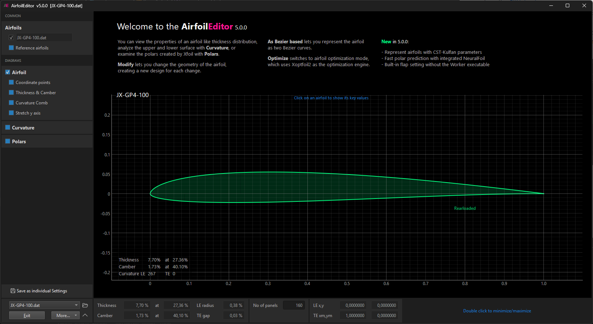

---

The **AirfoilEditor** is a fast airfoil viewer, analyzer, and advanced geometry editor with integrated Xoptfoil2-based optimization. The app provides three operating modes:

#### View
* Browse and view airfoils in subdirectories
* Analyze curvature of airfoil surface
* Generate polars using XFOIL or fast predictions using [NeuralFoil](https://github.com/peterdsharpe/NeuralFoil)
* Export airfoils to DXF format

#### Modify
* Repanel and normalize airfoils
* Adjust thickness, camber, high points, and trailing edge gap
* Blend two airfoils
* Set flap
* Generate airfoil replicas using Bezier, B-Spline or CST-Kulfan representations

#### Optimize
* User Interface of [Xoptfoil2](https://github.com/jxjo/Xoptfoil2)
* Graphical definition of polar-based objectives
* View results while optimizing

Requires Python 3.12 or newer. Install with `pip install airfoileditor`, then run `airfoileditor`.

The app uses the Qt UI framework and runs on Windows, Linux, and macOS.
View and Modify modes, including NeuralFoil polar prediction, work after package installation without additional binaries. XFOIL-based polar generation requires `worker`; optimization additionally requires `xoptfoil2`, both from the [Xoptfoil2](https://github.com/jxjo/Xoptfoil2) project.

Find more information about the **AirfoilEditor** on [GitHub](https://github.com/jxjo/AirfoilEditor).

---

Find release information in [CHANGELOG](https://github.com/jxjo/AirfoilEditor/blob/main/CHANGELOG.md).
